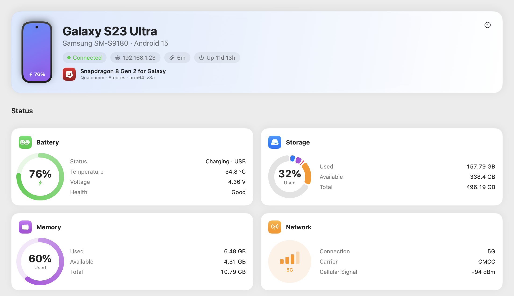
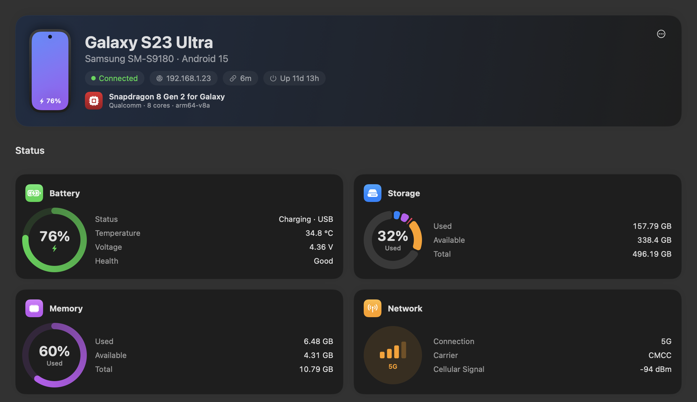
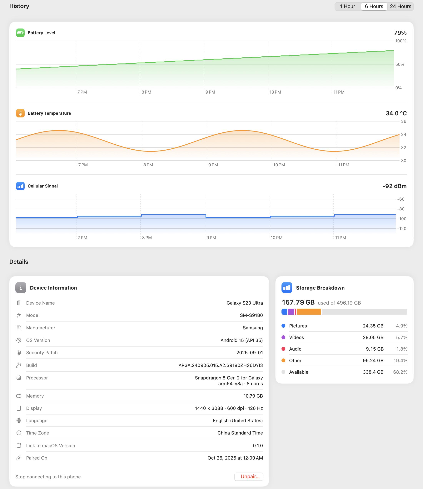
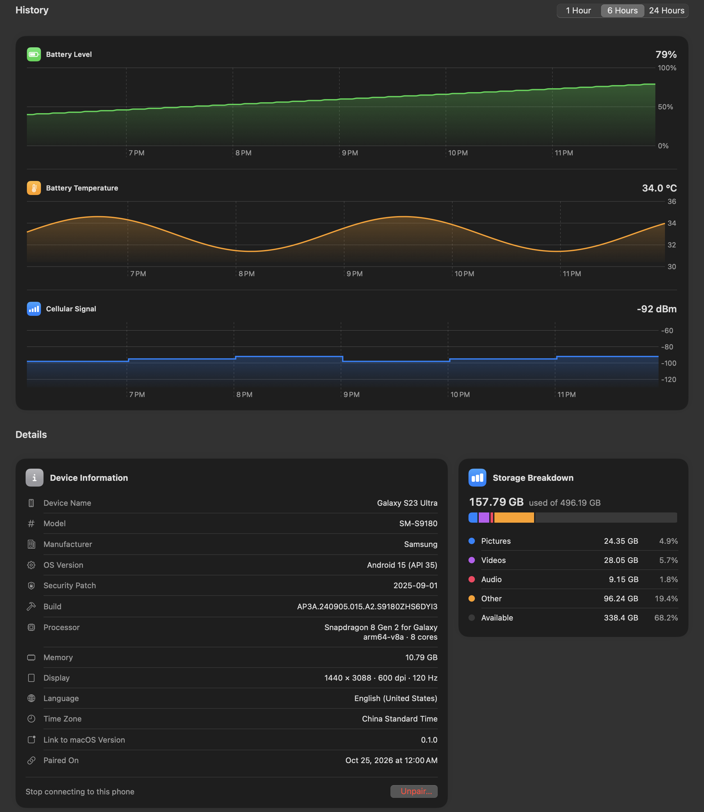
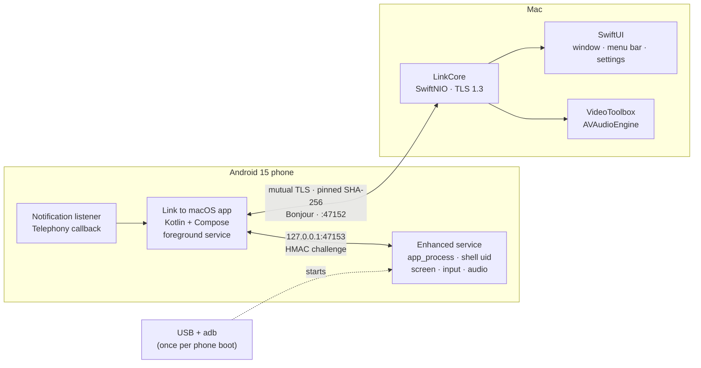

<div align="center">


# Link to macOS

**Your Android phone, on your Mac: notifications, photos & files, screen mirroring with sound and microphone, and incoming-call alerts — a native take on Microsoft's *Link to Windows*.**

English | [简体中文](README.zh-CN.md)

[](LICENSE)



&nbsp;&nbsp;


</div>

---

## ✨ What you get

| | Feature | What it does |
|---|---|---|
| 🔔 | **Notifications** | Phone notifications show up as native macOS notifications, with the app icon. Only apps you allow are forwarded. While the phone is connected it turns on **Do Not Disturb** by itself (calls can still ring) and turns it off when the Mac app quits. |
| 🖼️ | **Photos & Files** | A Finder-style window (translucent sidebar) to browse the phone's photos, videos, albums and every folder. Copy with ⌘C and paste into Finder, drag out, or save to a folder. Space previews a photo. |
| 📱 | **Screen mirroring** | Two modes. **Separate display** creates a virtual display on the phone, so the phone's own screen can stay off or locked while you use apps on the Mac. **Mirror** shows the phone screen as-is. The window keeps the phone's aspect ratio and turns landscape by itself for full-screen video. Mouse and keyboard become touch and keys. |
| 🔊 | **Sound & microphone** | The phone's sound plays on the Mac speakers (Opus). Your Mac microphone, with echo cancellation, becomes the phone's microphone for apps (voice messages, VoIP calls). |
| 📞 | **Call alerts** | An incoming call pops up a notification on the Mac and plays a ringtone you pick from the system sounds. A call that ends unanswered leaves a "Missed call" notice. Alerts only: the call audio stays on the phone. |
| 📋 | **Clipboard** | Copy text on one device, paste on the other. Phone → Mac is instant while the enhanced service is running (Android doesn't let normal apps read the clipboard in the background); otherwise it syncs when you open the app. Content that password managers mark as sensitive is never sent. |
| 📤 | **AirSend** | AirDrop-style, one tap. On the phone it's in the system **Share** sheet — as your Mac's name in the top row and as *AirSend* in the app list — and files, photos, links and text land in `Downloads/AirSend` on the Mac. On the Mac it's in the system **Share** menu (right-click a file in Finder → Share → AirSend), on the AirSend page (drag & drop) and in the menu bar. |
| 🧩 | **Widget & Quick Settings** | A native macOS widget (small, medium, large) with the phone's battery, storage, memory, network and a 24-hour battery curve. On Android a Quick Settings tile shows the connection at a glance. |
| 📊 | **Overview** | Battery, storage, memory and network at a glance, 1/6/24-hour history charts, device details and a storage breakdown. |
| ⌨️ | **Feels native** | Menu bar app, settings window (⌘,), a Go menu (⌘1–⌘7), a Screen Mirroring menu, ⌘R to refresh. |
| 🌍 | **Four languages** | English, 简体中文, 繁體中文 (Taiwan; the Android app also has Hong Kong) and 日本語, on both sides. |
| 🔐 | **Private by design** | No cloud, no account. Everything stays on your network over mutual TLS 1.3 with pinned certificates. |

## 🖼️ Overview page

<div align="center">


&nbsp;&nbsp;


</div>

## 🧭 Architecture



- **Link:** a TLS 1.3 connection with certificates on both sides, each pinned by its SHA-256 fingerprint. Pairing is a QR code with a single-use token. The phone finds the Mac through Bonjour (`_linktomacos._tcp`). Frames are length-prefixed JSON, plus binary frames for files, video and audio. See [docs/PROTOCOL.md](docs/PROTOCOL.md).
- **Enhanced service:** a small process on the phone started once over USB with `adb`. It runs as the `shell` user, which is what lets it read the screen, inject touches and record the system mix without asking for approval each time. After that you can unplug the cable. The approach follows [scrcpy](https://github.com/Genymobile/scrcpy).
- **Mirroring pipeline:** MediaCodec H.264 on the phone, VideoToolbox on the Mac. Opus for audio, 20 ms packets. Flow control drops frames instead of building up latency, which matters on a phone hotspot.

## 📁 Repository layout

```
android/                  Android app (Kotlin, Jetpack Compose, Material 3)
  app/src/main/java/com/linktomacos/android/
    link/                 connection service, notification + call monitoring, Do Not Disturb
    remote/               photos, files, device info, app list over the link
    mirror/               bridge to the enhanced service, stream forwarding
    shell/                the enhanced service (runs as shell via app_process)
macos/                    Mac app (SwiftUI) + XcodeGen project.yml
  Packages/LinkCore/      protocol, TLS server, pairing, remote API (Swift Package, tested)
  LinkToMacOS/            app: views, library, mirroring, audio, call alerts
docs/                     PROTOCOL.md, PLAN.md, images
design/                   icon generator (Mac icon)
tools/i18n/               scripts that generate the Mac String Catalogs and Android strings
spikes/hfp-spike/         Bluetooth HFP experiment (why call audio is not forwarded)
scripts/                  build-release.sh
```

## 🧰 Requirements

- **Mac:** macOS 15 or later. The release build is Apple silicon (arm64). Building from source needs Xcode with the Swift 6 toolchain and [XcodeGen](https://github.com/yonaskolb/XcodeGen) (`brew install xcodegen`).
- **Phone:** Android 15 or later (min SDK 35). Developed and tested on a Samsung Galaxy S23 Ultra (One UI 7).
- **For mirroring:** a USB cable once and **USB debugging** turned on. `adb` is built into the Mac app (a copy of Google's Platform-Tools build; no separate install). On Samsung phones also turn off **Auto Blocker**, otherwise USB debugging commands are blocked.
- **Network:** the phone and the Mac on the same Wi‑Fi, or the Mac connected to the phone's hotspot.

> The app is signed ad hoc, because it is built without an Apple developer account. The Android package is signed with the debug key. Both are meant for personal use.

## 🚀 Quick start

### 1. Build the packages

```bash
scripts/build-release.sh            # both; or: scripts/build-release.sh mac | android
```

You get, in `output/`:

| File | What it is |
|---|---|
| `Link-to-macOS-macos-arm64.zip` | the Mac app (Apple silicon) |
| `Link-to-macOS-android-arm64-v8a.apk` | the Android app (arm64-v8a) |
| `SHA256SUMS.txt` | checksums |

### 2. Install

```bash
# Mac: unzip, move "Link to macOS.app" to /Applications, then right-click → Open the first time
# Android: with the phone connected over USB. It installs over a debug build too, because both use the debug key,
# so pairing and permissions are kept. A build signed with a different key must be uninstalled first.
adb install -r output/Link-to-macOS-android-arm64-v8a.apk
```

### 3. Pair

1. On the Mac, click the menu bar icon → **Pair New Phone…**. A QR code appears.
2. On the phone, open **Link to macOS** → **Scan to Pair Mac**, and scan it. If scanning is not possible, copy the pairing link on the Mac and paste it on the phone.
3. Grant the permissions the phone app asks for: notification access, Do Not Disturb access, photos and all-files access (for Photos & Files), and phone state (for call alerts). On the Mac allow notifications and the local network.

### 4. Turn on screen mirroring (once per phone boot)

1. Plug the phone in over USB and accept **Allow USB debugging?**.
2. In the Mac app open **Screen Mirroring** → **Start Enhanced Service**. When it says it is running you can unplug the cable.
3. Open **Apps**, click an app, and it opens in the mirror window. Or use **Screen Mirroring** → **Start Mirroring**.

The service keeps running until the phone restarts. After a reinstall of the phone app, or a phone restart, start it again. The app checks the version and tells you when it is out of date.

## 📱 Screen mirroring in detail

| Mode | What happens | Good for |
|---|---|---|
| **Separate display** (default) | Apps open on a new virtual display inside the phone. The phone's own screen is untouched and can be off or locked. | Using phone apps from the Mac while the phone stays in your pocket. |
| **Mirror** | The phone's screen is shown as-is on the Mac, and the phone's panel is turned off by default. | Controlling the home screen and system UI. |

- **Quality presets:** Smooth (1280 px, 4 Mbps, good for hotspots), Standard (1920 px, 8 Mbps), High (2560 px, 16 Mbps), Native (the phone's own resolution and dpi, 24 Mbps). Pick **Native** if some app lays out wrongly on the scaled display.
- **Window:** a slim title bar and a small bar at the bottom with ◁ ○ ▢. It always keeps the phone's aspect ratio. When an app asks for landscape, the virtual display and the window turn landscape too.
- **Input:** left click is touch, right click is Back, middle click is Home, the wheel scrolls, Esc is Back, ⌘C/⌘V go to the phone as Ctrl+C/Ctrl+V. Typing non-ASCII text is not supported yet.
- **Sound:** on by default. The phone is silent while mirroring. `defaults write com.linktomacos.mac mirrorAudio -bool false` turns it off.
- **Microphone:** off by default and needs microphone permission on the Mac. `defaults write com.linktomacos.mac mirrorMicrophone -bool true` turns it on. (Settings for both are on the way.)

## ⌨️ Keyboard shortcuts

| Shortcut | Action |
|---|---|
| ⌘, | Settings |
| ⌘0 | Open the main window |
| ⌘1 … ⌘7 | Overview, Screen Mirroring, All Items, Videos, Apps, Internal Storage, Downloads |
| ⇧⌘N | Pair a new phone |
| ⌘R | Refresh the current page |
| Space | Preview the selected photo |
| ⌘[ / ⌘] / ⌘↑ | Files: back / forward / enclosing folder |
| ⇧⌘H / ⇧⌘R / ⇧⌘A / ⇧⌘O | Screen Mirroring menu: Home / Recents / open an app / turn the phone screen off or on |

## 🔧 Build from source

```bash
# Mac app (Debug)
cd macos && xcodegen generate
xcodebuild -project LinkToMacOS.xcodeproj -scheme LinkToMacOS -configuration Debug \
  -derivedDataPath build -clonedSourcePackagesDirPath Packages/.spm build
open "build/Products/Debug/Link to macOS.app"

# Android app (Debug), phone connected over USB
cd android && ./gradlew installDebug
```

Tests:

```bash
cd macos/Packages/LinkCore && swift test       # protocol, server, pairing, mirroring streams
cd android && ./gradlew testDebugUnitTest      # protocol, handshake, size maths
```

The text on both sides is generated from translation tables. **Edit `tools/i18n/mac_translations.py` and `tools/i18n/android_strings.py`, not the generated `.xcstrings` and `strings.xml`.** The details are in the scripts.

## 🛡️ Security model

- Mutual TLS 1.3 with self-signed certificates. Each side pins the other's SHA-256 fingerprint, so there is no certificate authority to trust.
- Pairing uses a one-time token in a QR code that expires in 5 minutes.
- The phone app and the enhanced service talk over `127.0.0.1` with an HMAC challenge. The shared secret never travels on the wire. Only a process that has it can control the service.
- Notifications are forwarded by an allowlist: nothing leaves the phone from an app you did not tick.
- The microphone is off by default, and the Mac asks for permission the first time.
- No cloud, no analytics. Photos and files go straight from the phone to the Mac.
- The enhanced service runs as the `shell` user. It can do what `adb shell` can do, so keep USB debugging and your adb keys to yourself.

## 🩺 Troubleshooting

| Symptom | What to check |
|---|---|
| The phone does not connect | Same network? On a hotspot the Mac must be joined to it. Allow the **Local Network** permission on the Mac, and keep the phone app's battery setting on *Unrestricted*. |
| "Enhanced service is not running" | USB cable, **USB debugging** on, and on Samsung **Auto Blocker** off. Then click **Start Enhanced Service** again. After the phone restarts it must be started again. |
| "Outdated, restart needed" | The phone app was reinstalled but the old service is still running. Start the enhanced service once more. |
| The Mac app will not open | It is ad hoc signed. Right-click → Open the first time, or `xattr -dr com.apple.quarantine "/Applications/Link to macOS.app"`. |
| No sound while mirroring | Check the Mac output device. The phone is silent on purpose while audio is forwarded. |
| The mic is not heard | `mirrorMicrophone` is on? The Mac asked for permission? The app on the phone must record from the microphone (not a call). |
| No call alert | The phone app has the **Phone** permission? Mac notifications allowed? The switch in Settings → General → Notifications is on? |
| Why can't I answer calls on the Mac? | macOS on Apple silicon refuses to open the Bluetooth voice link (SCO) as a headset, so the call audio cannot come to the Mac. Details in [docs/PLAN.md](docs/PLAN.md). VoIP calls (WhatsApp, WeChat…) work through mirroring. |

## 🗺️ Status

**Done:** pairing and encrypted link · notifications with an allowlist and automatic Do Not Disturb · Photos & Files · overview · screen mirroring (two modes, audio, microphone, landscape) · apps page · settings and shortcuts · call alerts · four languages.

**Not done:** a desktop widget · copying files from the Mac to the phone · non-ASCII text input while mirroring · multi-touch gestures · answering or dialing calls from the Mac.

## 📜 License and credits

[MIT](LICENSE) © 2026 Kazuma-Kobayashi01.

Built on [SwiftNIO](https://github.com/apple/swift-nio), [swift-nio-ssl](https://github.com/apple/swift-nio-ssl), [swift-certificates](https://github.com/apple/swift-certificates), [swift-crypto](https://github.com/apple/swift-crypto), [ZXing](https://github.com/zxing/zxing), AndroidX and Jetpack Compose (all Apache-2.0). The enhanced service is written after [scrcpy](https://github.com/Genymobile/scrcpy) (Apache-2.0). The full list, with versions and the required notices, is in [THIRD_PARTY_NOTICES.md](THIRD_PARTY_NOTICES.md); the Apache-2.0 text is in [LICENSES/Apache-2.0.txt](LICENSES/Apache-2.0.txt).

*Link to Windows* and *Phone Link* are Microsoft products, *macOS* is a trademark of Apple Inc., *Android* is a trademark of Google LLC. This project is independent and not affiliated with or endorsed by any of them.
