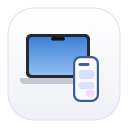
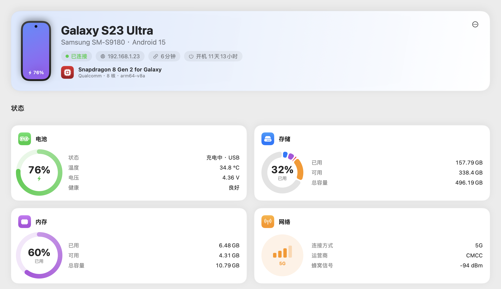
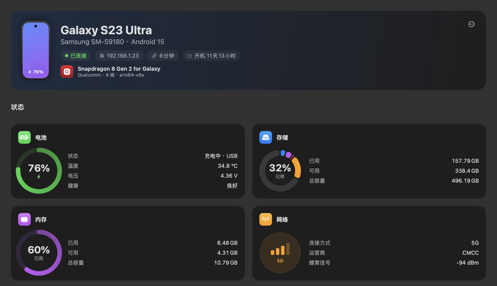
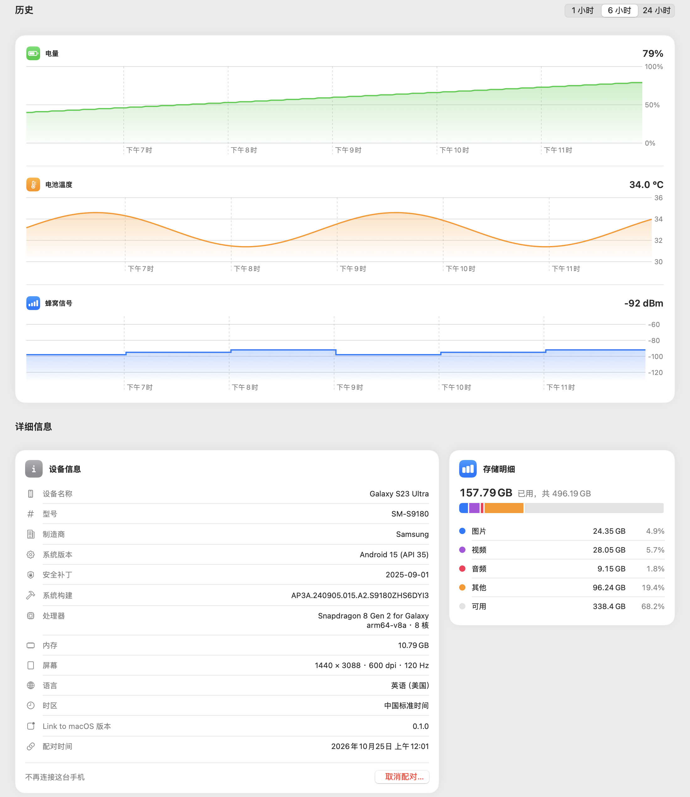
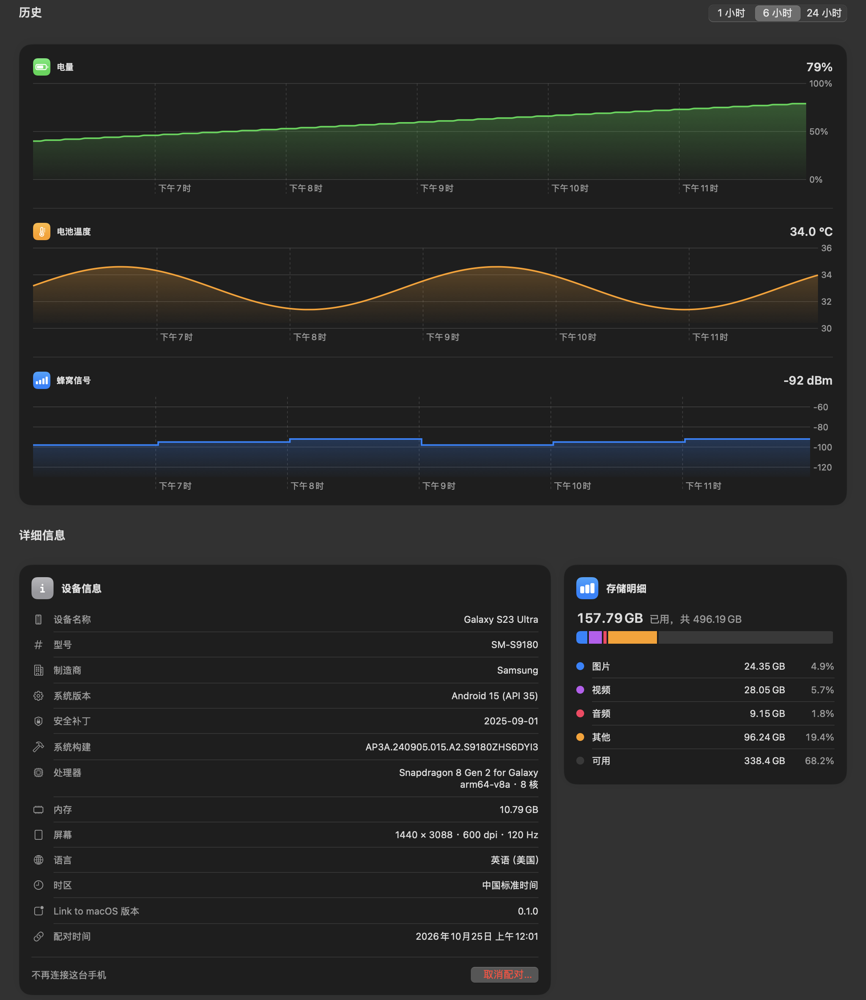
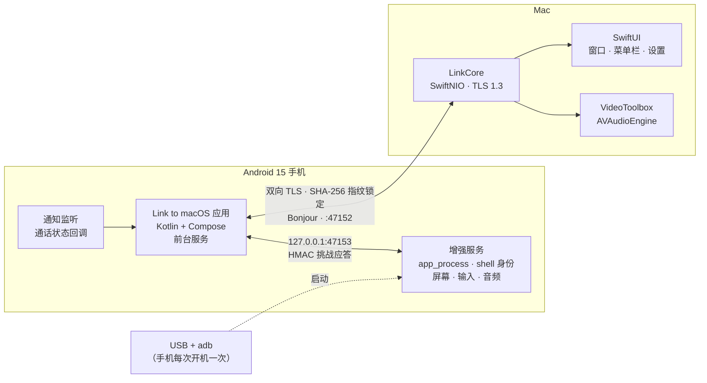

<div align="center">



# Link to macOS

**让 Android 手机和 Mac 互联：通知、相册与文件、带声音和麦克风的投屏、来电提示——一个原生的“连接到 Windows”。**

[English](README.md) | 简体中文

[](LICENSE)



&nbsp;&nbsp;


</div>

---

## ✨ 你会得到什么

| | 功能 | 作用 |
|---|---|---|
| 🔔 | **通知** | 手机通知以原生 macOS 通知显示，带应用图标。只转发你允许的应用。手机连接期间自动开启**免打扰**（来电仍然响铃），Mac 端退出后自动关闭。 |
| 🖼️ | **相册与文件** | 访达风格的窗口（半透明侧边栏），浏览手机的照片、视频、相簿和所有文件夹。⌘C 拷贝后可以在访达里粘贴，也可以拖出或存到文件夹。空格键预览照片。 |
| 📱 | **投屏** | 两种模式。**独立显示**在手机里新建一个虚拟显示器，手机自己的屏幕可以保持熄灭或锁屏，同时在 Mac 上用手机应用。**镜像**把手机屏幕原样显示出来。窗口固定为手机比例，全屏看视频时会自己转成横屏。鼠标键盘变成触摸和按键。 |
| 🔊 | **声音和麦克风** | 手机的声音从 Mac 扬声器播放（Opus）。Mac 的麦克风经回声消除后，变成手机应用的麦克风（语音消息、VoIP 通话）。 |
| 📞 | **来电提示** | 手机来电时，Mac 弹出通知，并播放你从系统提示音里挑的铃声。没接就挂的会留一条“未接来电”。只做提示：通话的声音留在手机上。 |
| 📊 | **概览** | 电池、存储、内存、网络一目了然，1/6/24 小时的历史曲线，设备详细信息和存储明细。 |
| ⌨️ | **原生手感** | 菜单栏应用、设置窗口（⌘,）、前往菜单（⌘1–⌘7）、投屏菜单、⌘R 刷新。 |
| 🌍 | **四种语言** | 两端都支持 English、简体中文、繁體中文（台湾；Android 另含香港）、日本語。 |
| 🔐 | **注重隐私** | 没有云，没有账号。一切都在你的网络里，走双向证书锁定的 TLS 1.3。 |

## 🖼️ 概览页

<div align="center">


&nbsp;&nbsp;


</div>

## 🧭 架构



- **连接：** 两端都带证书的 TLS 1.3，各自按 SHA-256 指纹锁定对方。配对用二维码，里面是一次性令牌。手机通过 Bonjour（`_linktomacos._tcp`）找到 Mac。帧是带长度前缀的 JSON，文件、视频、音频走二进制帧。详见 [docs/PROTOCOL.md](docs/PROTOCOL.md)。
- **增强服务：** 手机上的一个小进程，通过 USB 用 `adb` 启动一次。它以 `shell` 身份运行，所以能读屏幕、注入触摸、录系统声音，而不用每次都弹授权。之后可以拔掉数据线。做法参考 [scrcpy](https://github.com/Genymobile/scrcpy)。
- **投屏流水线：** 手机上 MediaCodec 编码 H.264，Mac 上 VideoToolbox 解码；音频用 Opus，每包 20 ms。流控会丢帧而不是堆积延迟，这在手机热点下很重要。

## 📁 仓库结构

```
android/                  Android 应用（Kotlin、Jetpack Compose、Material 3）
  app/src/main/java/com/linktomacos/android/
    link/                 连接服务、通知和通话监听、免打扰
    remote/               通过连接提供照片、文件、设备信息、应用列表
    mirror/               与增强服务的桥、数据流转发
    shell/                增强服务（用 app_process 以 shell 身份运行）
macos/                    Mac 应用（SwiftUI）+ XcodeGen 的 project.yml
  Packages/LinkCore/      协议、TLS 服务、配对、远程接口（Swift Package，有测试）
  LinkToMacOS/            应用：界面、资料库、投屏、音频、来电提示
docs/                     PROTOCOL.md、PLAN.md、图片
design/                   图标生成脚本（Mac 图标）
tools/i18n/               生成 Mac String Catalog 和 Android strings 的脚本
spikes/hfp-spike/         蓝牙 HFP 实验（为什么不转发通话声音）
scripts/                  build-release.sh
```

## 🧰 准备工作

- **Mac：** macOS 15 及以上。release 包是 Apple 芯片（arm64）。从源码构建需要带 Swift 6 工具链的 Xcode 和 [XcodeGen](https://github.com/yonaskolb/XcodeGen)（`brew install xcodegen`）。
- **手机：** Android 15 及以上（最低 SDK 35）。在三星 Galaxy S23 Ultra（One UI 7）上开发和测试。
- **投屏需要：** Mac 上有 `adb`（Android Studio 自带，或 `brew install android-platform-tools`），用一次 USB 数据线，并打开 **USB 调试**。三星手机还要关闭**自动拦截器**，否则会拦截 USB 调试命令。
- **网络：** 手机和 Mac 在同一个 Wi‑Fi，或者 Mac 连着手机的热点。

> 应用是 ad-hoc 签名（没有 Apple 开发者账号）。Android 安装包用调试密钥签名。都只供个人使用。

## 🚀 快速开始

### 1. 构建安装包

```bash
scripts/build-release.sh            # 两个都构建；也可以：scripts/build-release.sh mac | android
```

结果在 `output/` 里：

| 文件 | 说明 |
|---|---|
| `Link-to-macOS-macos-arm64.zip` | Mac 应用（Apple 芯片） |
| `Link-to-macOS-android-arm64-v8a.apk` | Android 应用（arm64-v8a） |
| `SHA256SUMS.txt` | 校验和 |

### 2. 安装

```bash
# Mac：解压，把“Link to macOS.app”拖进“应用程序”，第一次右键 → 打开
# Android：手机用 USB 连着。可以直接覆盖安装在调试版上（两者用同一把调试密钥），配对和权限都保留；
# 如果以前装的是别的密钥签名的版本，要先卸载
adb install -r output/Link-to-macOS-android-arm64-v8a.apk
```

### 3. 配对

1. 在 Mac 上点菜单栏图标 → **配对新手机…**，会出现二维码。
2. 在手机上打开 **Link to macOS** → **扫码配对 Mac**，扫描二维码。扫不了的话，在 Mac 上复制配对链接，粘贴到手机上。
3. 授予手机 App 请求的权限：通知访问、免打扰权限、相册和所有文件访问（相册与文件用）、电话状态（来电提示用）。Mac 上允许通知和本地网络。

### 4. 开启投屏（手机每次开机一次）

1. 用 USB 连上手机，在手机上点**允许 USB 调试**。
2. 在 Mac 应用里打开**投屏** → **启动增强服务**。显示运行中就可以拔掉数据线了。
3. 打开**应用**，点一个应用，它就在投屏窗口里打开。也可以在**投屏**页点**开始投屏**。

服务会一直运行，直到手机重启。重新安装手机 App 或手机重启之后，需要再启动一次；应用会检查版本，过期时会提示。

## 📱 投屏详解

| 模式 | 会怎样 | 适合 |
|---|---|---|
| **独立显示**（默认） | 应用开在手机里新建的虚拟显示器上。手机自己的屏幕不受影响，可以熄灭或锁屏。 | 手机放口袋里，在 Mac 上用手机应用。 |
| **镜像** | 手机屏幕原样显示在 Mac 上，默认关闭手机的屏幕面板。 | 操控桌面和系统界面。 |

- **画质预设：** 流畅（1280 像素、4 Mbps，适合热点）、标准（1920 像素、8 Mbps）、高清（2560 像素、16 Mbps）、原生（手机自己的分辨率和 dpi，24 Mbps）。某个应用在缩放后的显示器上排版不对时，选**原生**。
- **窗口：** 精简的标题栏，底部一条带 ◁ ○ ▢ 的小栏。窗口始终保持手机比例；应用要求横屏时，虚拟显示器和窗口一起转成横向。
- **输入：** 左键是触摸，右键是返回，中键是主页，滚轮滑动，Esc 是返回，⌘C/⌘V 当作 Ctrl+C/Ctrl+V 发给手机。暂不支持输入中文等非 ASCII 文字。
- **声音：** 默认开启，投屏时手机本体静音。`defaults write com.linktomacos.mac mirrorAudio -bool false` 可以关闭。
- **麦克风：** 默认关闭，需要 Mac 的麦克风权限。`defaults write com.linktomacos.mac mirrorMicrophone -bool true` 打开。（这两项的设置界面还在做。）

## ⌨️ 快捷键

| 快捷键 | 功能 |
|---|---|
| ⌘, | 设置 |
| ⌘0 | 打开主窗口 |
| ⌘1 … ⌘7 | 概览、投屏、所有项目、视频、应用、内部存储、下载 |
| ⇧⌘N | 配对新手机 |
| ⌘R | 刷新当前页面 |
| 空格 | 预览所选照片 |
| ⌘[ / ⌘] / ⌘↑ | 文件：后退 / 前进 / 上一级 |
| ⇧⌘H / ⇧⌘R / ⇧⌘A / ⇧⌘O | 投屏菜单：主页 / 最近任务 / 打开应用 / 关闭或打开手机屏幕 |

## 🔧 从源码构建

```bash
# Mac 应用（Debug）
cd macos && xcodegen generate
xcodebuild -project LinkToMacOS.xcodeproj -scheme LinkToMacOS -configuration Debug \
  -derivedDataPath build -clonedSourcePackagesDirPath Packages/.spm build
open "build/Products/Debug/Link to macOS.app"

# Android 应用（Debug），手机用 USB 连着
cd android && ./gradlew installDebug
```

测试：

```bash
cd macos/Packages/LinkCore && swift test       # 协议、服务、配对、投屏数据流
cd android && ./gradlew testDebugUnitTest      # 协议、握手、尺寸计算
```

两端的界面文字都由翻译表生成。**要改文字，改 `tools/i18n/mac_translations.py` 和 `tools/i18n/android_strings.py`，不要直接改生成出来的 `.xcstrings` 和 `strings.xml`。** 用法见脚本里的说明。

## 🛡️ 安全模型

- 双向 TLS 1.3，自签名证书。两端各自锁定对方的 SHA-256 指纹，不依赖任何证书颁发机构。
- 配对用二维码里的一次性令牌，5 分钟后失效。
- 手机 App 和增强服务通过 `127.0.0.1` 通信，用 HMAC 挑战应答认证，共享密钥从不上线。只有拿到密钥的进程才能控制服务。
- 通知按白名单转发：你没勾选的应用，什么都不会离开手机。
- 麦克风默认关闭，Mac 在第一次使用时会请求权限。
- 没有云，没有统计。照片和文件从手机直接传到 Mac。
- 增强服务以 `shell` 身份运行，能做 `adb shell` 能做的事，所以请保管好 USB 调试和你的 adb 密钥。

## 🩺 常见问题

| 现象 | 排查 |
|---|---|
| 手机连不上 | 在同一个网络吗？用热点的话，Mac 要连着它。Mac 上允许**本地网络**权限，手机 App 的电池设置保持“不受限制”。 |
| “增强服务未运行” | USB 数据线、**USB 调试**是否打开，三星手机要关闭**自动拦截器**。然后再点一次**启动增强服务**。手机重启后要重新启动。 |
| “版本过旧，需要重新启动” | 手机 App 重装过，但旧的服务还在跑。再启动一次增强服务。 |
| Mac 应用打不开 | 它是 ad-hoc 签名。第一次右键 → 打开，或者 `xattr -dr com.apple.quarantine "/Applications/Link to macOS.app"`。 |
| 投屏时没有声音 | 看看 Mac 的输出设备。转发声音时手机本体是静音的，这是有意的。 |
| 听不到麦克风 | `mirrorMicrophone` 打开了吗？Mac 弹过权限请求吗？手机上的应用要用麦克风录音（不是通话）。 |
| 来电没有提示 | 手机 App 有**电话**权限吗？Mac 允许通知了吗？设置 → 通用 → 通知里的开关打开了吗？ |
| 为什么不能在 Mac 上接电话？ | Apple 芯片上的 macOS 不允许应用以耳机身份打开蓝牙语音链路（SCO），通话的声音到不了 Mac。详情见 [docs/PLAN.md](docs/PLAN.md)。VoIP 通话（微信、WhatsApp 等）可以通过投屏使用。 |

## 🗺️ 进度

**已完成：** 配对和加密连接 · 通知（白名单、自动免打扰）· 相册与文件 · 概览 · 投屏（两种模式、声音、麦克风、横屏）· 应用页 · 设置和快捷键 · 来电提示 · 四种语言。

**未完成：** 桌面小组件 · 从 Mac 复制文件到手机 · 投屏时输入非 ASCII 文字 · 多点触控手势 · 在 Mac 上接听或拨打电话。

## 📜 许可证与致谢

[MIT](LICENSE) © 2026 Kazuma-Kobayashi01。

使用了 [SwiftNIO](https://github.com/apple/swift-nio)、[swift-nio-ssl](https://github.com/apple/swift-nio-ssl)、[swift-certificates](https://github.com/apple/swift-certificates)、[swift-crypto](https://github.com/apple/swift-crypto)、[ZXing](https://github.com/zxing/zxing)、AndroidX 和 Jetpack Compose（都是 Apache-2.0）。增强服务参照 [scrcpy](https://github.com/Genymobile/scrcpy)（Apache-2.0）的思路重新编写。完整清单（含版本和要求附上的声明）见 [THIRD_PARTY_NOTICES.md](THIRD_PARTY_NOTICES.md)，Apache-2.0 全文见 [LICENSES/Apache-2.0.txt](LICENSES/Apache-2.0.txt)。

*连接到 Windows* 和 *Phone Link* 是 Microsoft 的产品，*macOS* 是 Apple Inc. 的商标，*Android* 是 Google LLC 的商标。本项目是独立项目，与它们无隶属或认可关系。
